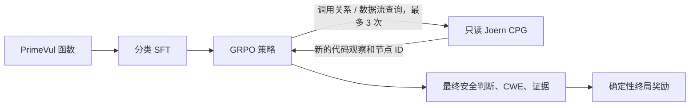

# 层级奖励驱动的 CPG 探索式 CWE 分类

这是一个面向 C/C++ 漏洞分类的简化研究实现。模型先用常规监督微调学习输出格式和基本分类，再通过标准 GRPO 学会是否查询、查询什么以及何时结束。研究重点是：**在相同工具预算下，用 CWE 层级奖励训练的智能体是否比精确匹配奖励更能找对漏洞类型？**

实验组、数据划分、统计方法和结果预估见 [实验设计与结果预估](EXPERIMENT_PLAN.md)。

## 设计概览



Harness 是多轮 RL 的环境：每次查询都会返回新的、带稳定节点 ID 的代码观察。没有 Harness 时，模型只能对同一段文本反复生成内容，不能声称学到了主动探索。本项目的 Harness 只读，不运行模型生成的代码或查询。

## 方法

1. **监督初始化：** 用训练集做普通函数级分类 SFT，目标为 JSON 格式的 `verdict`、`cwe_id` 和 `evidence_node_ids`。标签不放进输入提示。
2. **多轮环境：** 训练时提供三个操作：`get_callers`、`get_callees`、`dataflow_slice`。每个样本最多查询 3 次；模型输出最终预测即表示停止。
3. **标准 GRPO：** 同一函数采样多条完整轨迹，按轨迹最终分数做组内相对优化。没有逐轮奖励塑形，也不修改 VERL 的 advantage 计算。
4. **奖励对比：** 主方法使用完整 CWE 层级的归一化 ALPHA 分数；对照组将该项替换为 CWE 精确匹配。两组共享相同的证据有效性和查询成本奖励，不单设二元正确性奖励项。

终局分数不单独加入二元正确性项：

`R = 0.80 × R_classification + 0.10 × R_evidence + 0.10 × R_efficiency`

其中，漏洞样本的 `R_classification` 为归一化 ALPHA 层级得分（对照组为 CWE 精确匹配）；安全样本预测为安全得 1，预测为漏洞得 0。这样安全/漏洞判断由同一个分类任务分数处理，不再额外叠加 `R_binary`。`R_evidence` 检查最终引用的节点是否来自初始观察或工具结果；安全预测不要求引用漏洞节点。`R_efficiency = 1 − 查询数/3`。二元 F1 仅用于评估，不参与 RL 奖励。所有奖励由程序确定性计算，不使用 LLM-as-judge，且不返回给模型。

## 数据和评估

- **PrimeVul：** 主训练、验证和测试集，使用官方划分。
- **BigVul：** 独立外部评估。CWE 指标只在抽样人工审计通过的子集上报告；未审计标签不作为可靠的 RL 奖励或结论依据。
- **去重：** 以规范化函数代码哈希为主，并利用可用的 CVE、提交和项目元数据排查跨集重复；优先保留 PrimeVul 官方测试样本。
- **固定分类体系：** 冻结 MITRE CWE 4.20 快照，用于训练奖励和离线评估。

主要指标：CWE Macro-F1、归一化 ALPHA、二元 F1、平均查询数和有效证据率。主结果比较普通分类 SFT、精确匹配奖励的工具 GRPO、层级奖励的工具 GRPO。使用 3 个随机种子和配对 bootstrap 置信区间；只按验证集选择 checkpoint。

核心主张可被明确证伪：若层级奖励 GRPO 在固定查询预算下没有优于精确匹配 GRPO，或 CWE 改善以明显损害二元 F1 为代价，就不支持该方法主张。

## 最小运行流程

以下命令假设 Linux 训练节点已安装 Joern、VERL 和 SGLang。集群依赖版本应固定，尤其是 VERL 的 AgentLoop API。

### 1. 准备数据与 CWE 分类体系

```bash
pip install -e '.[data,train]'
vulnrl-prepare \
  --primevul ./data/primevul.jsonl \
  --bigvul ./data/bigvul.csv \
  --out-dir ./artifacts/data \
  --no-bigvul-augmentation

vulnrl-taxonomy \
  --xml ./data/cwec_v4.20.xml \
  --out ./artifacts/cwe_4_20.json
```

BigVul 可先用于外部评估；若没有审计映射，不将其 CWE 标签用于 RL 训练。
`bigvul_eval.jsonl` 已排除与 PrimeVul 重复的函数。准备好 `sample_id,cwe_id` 审计表后，可在准备命令中加入 `--bigvul-cwe-audit ./data/bigvul_cwe_audit.csv`。

导出 GRPO 所需的训练和验证文件：

```bash
vulnrl-export-verl --input ./artifacts/data/primevul_train.jsonl --out ./artifacts/train.parquet
vulnrl-export-verl --input ./artifacts/data/primevul_val.jsonl --out ./artifacts/valid.parquet
```

### 2. 准备只读 CPG

对数据中的仓库固定 revision 离线生成 Joern CPG，再导出 GraphML 并转换。一个 CPG 可供同一仓库快照下的多个函数复用。

```bash
vulnrl-joern-graphml \
  --graphml ./joern/repo/export/cpg.graphml \
  --project-id repo@commit \
  --out ./artifacts/cpg/repo.json

vulnrl-build-cpg-index \
  --dataset ./artifacts/data/primevul_train.jsonl \
  --dataset ./artifacts/data/primevul_val.jsonl \
  --dataset ./artifacts/data/primevul_test.jsonl \
  --dataset ./artifacts/data/bigvul_eval.jsonl \
  --project-map ./project_map.json \
  --snapshot-dir ./artifacts/cpg \
  --out ./artifacts/cpg/index.json
```

索引生成后需要检查未匹配或歧义函数。Harness 仅开放调用关系和数据流操作，返回有限数量的代码节点。

### 3. SFT 初始化

```bash
vulnrl-build-sft-examples \
  --input ./artifacts/data/primevul_train.jsonl \
  --out ./artifacts/sft.jsonl

torchrun --standalone --nproc_per_node=4 -m vulnrl.train_sft \
  --model Qwen/Qwen2.5-Coder-7B-Instruct \
  --traces ./artifacts/sft.jsonl \
  --out /mnt/checkpoints/cwe-classifier-sft
```

### 4. 运行工具 GRPO

```bash
export TRAIN_PARQUET=/mnt/data/train.parquet
export VAL_PARQUET=/mnt/data/primevul_valid.parquet
export TAXONOMY_JSON=/mnt/data/cwe_4_20.json
export CPG_SNAPSHOT_DIR=/mnt/data/cpg
export MODEL_PATH=/mnt/checkpoints/cwe-classifier-sft
export CHECKPOINT_DIR=/mnt/checkpoints/cwe-grpo-alpha
export HIERARCHY_REWARD_MODE=alpha
bash scripts/run_grpo.sh
```

以精确 CWE 匹配奖励运行对照组时，使用同一数据、初始化模型和超参数，并设置独立输出目录：

```bash
export CHECKPOINT_DIR=/mnt/checkpoints/cwe-grpo-exact
export HIERARCHY_REWARD_MODE=exact
bash scripts/run_grpo.sh
```

配置集中在 [configs/experiment.yaml](configs/experiment.yaml)。主要训练参数为 Qwen2.5-Coder-7B、4×H100 80GB、每个 prompt 采样 8 条轨迹、学习率 `3e-6`、最多 3 次查询。单次训练脚本用于一组固定配置，不再执行多阶段交互长度课程。

PrimeVul 测试集照常评估；BigVul 外部评估需对 CWE 指标启用审计过滤：

```bash
vulnrl-evaluate \
  --labels ./artifacts/data/bigvul_eval.jsonl \
  --predictions ./artifacts/bigvul_predictions.jsonl \
  --taxonomy ./artifacts/cwe_4_20.json \
  --require-audited-cwe \
  --out ./artifacts/bigvul_metrics.json
```

开启该选项后，二元指标仍使用全部 BigVul 样本；CWE 指标只使用 `cwe_label_status=audited` 的样本。

## 与已有工作的边界

Li 等已研究 CPG 工具和多轮 RL 漏洞检测；Adnan 等已研究单轮 CWE 预测中的层级奖励。因此，本项目不把“调用工具”或“使用层级奖励”单独作为创新。待检验的窄问题是：**把完整 CWE 层级分数作为多轮 CPG 探索的终局奖励，能否改善工具使用下的 CWE 分类质量与查询效率。**

- [Li et al., Graph is the Verifier](https://arxiv.org/abs/2607.26656)
- [Adnan et al., From Evaluation to Optimisation](https://arxiv.org/abs/2607.21069)
- [DeepSeekMath / GRPO](https://arxiv.org/abs/2402.03300)
- [VERL AgentLoop documentation](https://verl.readthedocs.io/en/latest/advance/agent_loop.html)
